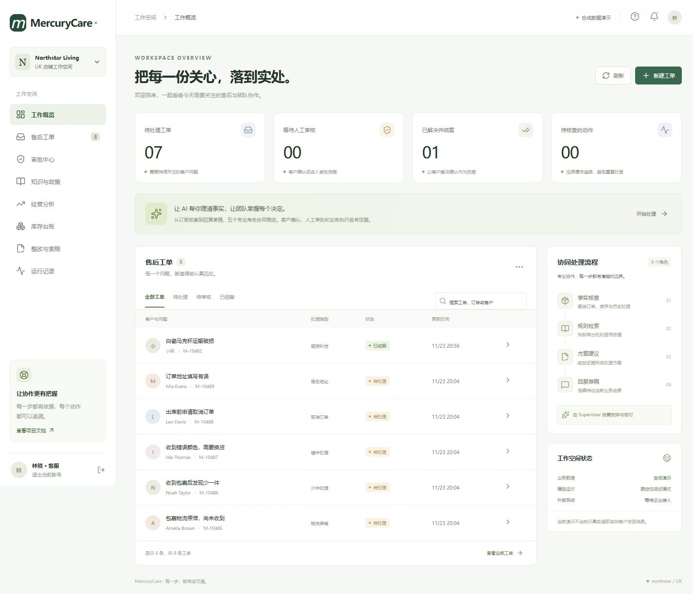
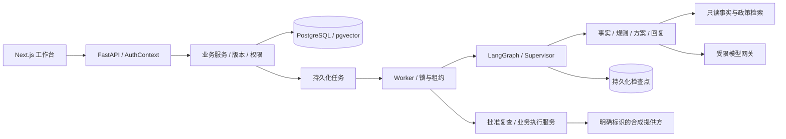

# MercuryCare

**让每一次售后，都有可信的下一步。**

MercuryCare 是一个跨境电商售后与经营协同应用，提供中文工作台、受限五角色协作、人工审批、可追溯执行和经营复查。前端使用 Next.js / TypeScript，后端使用 FastAPI / SQLAlchemy，工作流使用 LangGraph，支持 PostgreSQL / pgvector 和本地 SQLite 演示。

> 当前为 **v0.1 企业应用工程基线**：本地合成业务可运行并有自动化验证。真实 OIDC、模型效果、OMS/WMS、支付、物流、通知及生产恢复仍需企业配置与验收。它不是已经通过企业上线验收的成品。完整边界见 [接入矩阵](docs/integration-matrix.md) 和 [阶段进度](docs/progress.md)。

[](https://github.com/yxp-system/mercury-care/actions/workflows/ci.yml?query=branch%3Amain)



实际浏览器已完成客户确认、独立审批、执行、出库、送达、解决确认和客服结案。详见 [验收记录](docs/acceptance.md)。

## 功能

- **售后工作台**：工单、订单行、沟通、证据附件、政策引用、方案版本、客户选择、审核和执行记录。
- **售后分支**：补发、退款、退货、物流调查、取消、改址、少件、错件，使用同一权限、审批和防重服务。
- **五角色协作**：Supervisor、事实、规则、方案、回复。LangGraph 管理图进度，数据库保存审批和执行真值。简单物流查询走事实加回复短路径。
- **执行可靠性**：稳定动作和原请求关联、数据库 Outbox、工作进程锁与租约、重复事件识别、回执未知核查、库存预留与结转、退款占用。
- **团队与数据**：JWT/OIDC 验证、服务端岗位授权、租户/店铺范围、客户归属、PostgreSQL 行级策略、审计记录、规则独立审核。
- **经营协同**：订单去重统计、整改假设和复查、独立内部索赔、规则草稿/审核/撤回、版本保留。
- **交付工具**：Alembic 迁移、健康检查、Prometheus 指标、Docker Compose、CI 和隔离备份验证。

## 快速运行

需要 Python 3.12、Node.js 24、[uv](https://docs.astral.sh/uv/)。默认只监听本机，使用独立 `.data/` 合成数据库。

```bash
git clone https://github.com/yxp-system/mercury-care.git
cd mercury-care
uv sync --frozen
uv run python -m mercury.cli configure
uv run python -m mercury.cli migrate
uv run python -m mercury.cli seed
```

在三个终端运行：

```bash
# 终端 1：API
uv run uvicorn mercury.api:create_app --factory --host 127.0.0.1 --port 8040

# 终端 2：持久化 worker
uv run python -m mercury.worker

# 终端 3：工作台
cd apps/web
npm ci
npm run dev
```

打开 [工作台](http://127.0.0.1:3040) 或 [API 文档](http://127.0.0.1:8040/docs)。Windows 可以在仓库根目录运行 `./scripts/start-demo.ps1`，用 `./scripts/stop-demo.ps1` 停止对应进程。

`configure` 生成被 Git 忽略的 `.env` 和随机签名密钥。演示账号共用演示密码 **`MercuryDemo-2026!`**；这是公开的本地合成测试凭据，不应部署到公网。测试账号与真实企业身份严格分开。

| 账号 | 用途 |
|---|---|
| `demo` | 浏览工作台、制定方案、查看运行与业务记录 |
| `agent` | 客服受理、方案与回复 |
| `customer` | 小林的订单客户，确认方案/问题解决 |
| `manager` | 店铺人工审批 |
| `executor` | 执行已批准动作、核查原请求与合成履约事件 |
| `ops` | 经营统计、整改、内部索赔 |
| `editor` / `reviewer` | 知识编辑 / 独立审核 |
| `outsider` | 另一租户的隔离测试账号 |

批准与执行必须使用不同账号。`demo` 拥有多个演示岗位，但不能用同一身份批准并执行同一个动作。

## 跑通主案例

1. `agent` 打开 `M-10482` 白杯破损工单，点击「开始协同分析」。worker 会查事实、检索规则、生成方案和草稿；刷新查看运行记录。
2. 退出并以 `customer` 登录，打开同一工单，确认方案。
3. `manager` 审批当前方案；`executor` 执行已批准方案。刷新等待 worker 回执。
4. 库存从在库 3、预留 0、可用 3，变为在库 3、预留 1、可用 2。
5. `executor` 点击合成出库、送达事件；出库后在库 2、预留 0、可用仍为 2。
6. `customer` 确认问题已解决，`agent` 再结案。签收或建单本身不会自动结案。

演示通知只写本地可核查记录，不联系真实客户；模型模式默认 `deterministic_test`，仅验证应用流程。切换 `real` 需要模型名、HTTPS 服务地址和 API key，失败时不会退回测试答案。

## PostgreSQL / Docker

先运行 `configure`，在本地 `.env` 增加随机生成的 `POSTGRES_PASSWORD`、`POSTGRES_APP_PASSWORD`，再执行：

```bash
docker compose up --build -d
docker compose logs -f api worker
docker compose down
```

迁移容器使用 owner，运行服务使用不具 `SUPERUSER`/`BYPASSRLS` 的 `mercury_app`。Compose 为单机演示拓扑，不自动提供高可用；不要使用 `down -v` 作为日常停止方式。企业部署须阅读 [运维与恢复](docs/operations.md)、[安全模型](docs/security-model.md)。

## 检查

```bash
uv run pytest -q
uv run ruff check apps/api tests scripts
uv run ruff format --check apps/api tests scripts migrations
cd apps/web
npm run build
npm run typecheck
```

PostgreSQL 测试通过 `TEST_DATABASE_URL` 启用，数据库名必须包含 `test`。该测试会重建测试业务表，禁止指向业务库。CI 运行 SQLite 和 PostgreSQL 两套测试，包括受限数据库角色、独立进程恢复和迁移检查。

## 结构与边界

```text
apps/api/mercury/    API、身份、域服务、模型网关、LangGraph、worker
apps/web/           Next.js 工作台与 HttpOnly 会话代理
migrations/         可追踪数据库迁移及 PostgreSQL 行级策略
tests/              业务、安全、并发与恢复测试
deploy/             容器构建
scripts/            启动、初始化与隔离备份验证
docs/               契约、进度、接入、验收和原始需求文档
```



外部平台的接口、授权、幂等和查询语义无法从提示词推导。当前 `external` 模式明确拒绝未接入的读取和写入，生产就绪检查会指出缺失集成。没有预填通过率、伪造真实模型结果或上线签署。

完整说明：[文档索引](docs/index.md) · [已知限制](docs/limitations.md) · [原始分阶段需求](docs/reference/implementation-prompts.zh-CN.md)

## 开源

[MIT License](LICENSE)。欢迎通过 Issue 提供复现步骤或通过 PR 改进。涉及安全问题请先阅读 [SECURITY.md](SECURITY.md)，不要公开真实客户资料和凭据。
