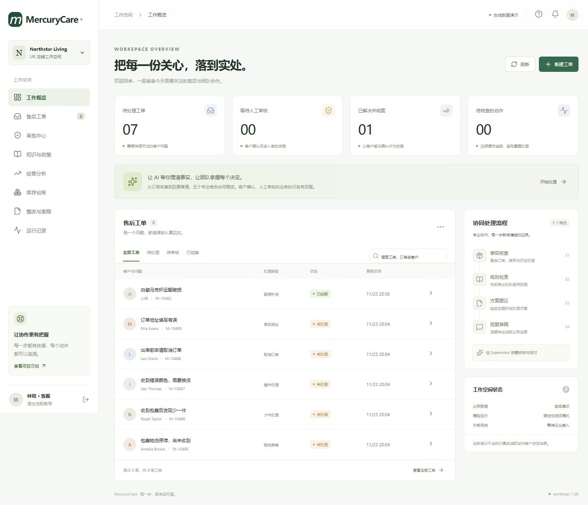

# 验收记录

执行日期：2026-11-23。环境：Windows、Python 3.12.9、Node.js 24.18.0；业务源为 synthetic，模型为 deterministic_test。所有数据为仓库种子和隔离测试生成。

已执行：

```text
uv sync
uv run python -m mercury.cli configure
uv run python -m mercury.cli migrate
uv run python -m mercury.cli seed
uv run pytest -q --tb=short --junitxml=.data/local-tests.xml
```

v0.1 后端结果：**42 passed, 1 skipped**，101.14 秒。跳过项为需 PostgreSQL 的受限角色 RLS 测试；本机未安装 PostgreSQL/Docker。其余测试使用真实 SQLite 数据库、真实应用服务与显式测试模型。新增用例验证通知提交时的工单版本，拒绝旧状态内容且不创建 Outbox 任务。

覆盖证据：

- `test_business.py`：五角色完整补发、审批、库存守恒、客户确认与结案/重开；退款、退货、物流、少件、错件、取消、改址；重复请求/事件30次、并发预留、退款未知占用和失败释放。
- `test_security.py`：JWT伪造、即时撤权、租户/客户隔离、岗位拒绝、跨租户外键、附件类型与越权、入站去重、乐观版本、政策适用期/审核/撤回、Webhook签名绑定路径、生产模式拒绝替身。
- `test_recovery.py`：新 worker 进程读取持久 checkpoint、等待不增加预算、批准后新进程恢复、规则撤回拒绝执行、通知防重、索赔独立、整改样本门禁、未知查无不重发、持久预算、审批执行身份分离、原请求过期后仍可查询、二次赔付权益限制。

附加验证：真实模式通过 MockTransport 模拟非法动作和鉴权失败，验证无越权执行、无静默替身、未知用量继续占用；这不是对真实模型提供商的调用证明。

隔离 SQLite 备份已执行，SHA256、integrity_check、foreign_key_check 均通过，16个合成工单完整。独立 API 与 worker 默认配置启动成功，主案例运行到 waiting，记录9次模型角色调用。

以下是前端构建、浏览器和远程 CI 的实际验证结果。不填未经运行的真实模型效果、生产吞吐、企业收益或上线签署。


GitHub CI（提交 `289cf741231422315457017db8a7064d53f080d5`）已实际通过：[运行记录](https://github.com/yxp-system/mercury-care/actions/runs/45176404118)。Ubuntu 上 SQLite **41 passed, 1 skipped**，PostgreSQL/pgvector **42 passed**，包括非 owner 的 RLS 和独立进程恢复；Alembic upgrade → downgrade → upgrade 成功。前端 build、typecheck、npm audit 高危门禁与 API/web Docker 镜像构建全部成功。

本地生产前端构建与 TypeScript 检查通过。浏览器发现并修复了 localhost / 127.0.0.1 同源处理及切换账号的旧界面状态残留；同源登录200、跨源写入403。小林账号仅能看到自身一个工单，已实际从页面确认方案，再以 manager 账号批准；角色调用及审计记录可读取。

后续提交 `cc90554ef7c36fa241e7f73019d12af1cbdcf67f` 的 [CI](https://github.com/yxp-system/mercury-care/actions/runs/45178183639) 也全部成功，包含 backend、frontend 和 images 三个作业。最新分支结果可在 [CI 页面](https://github.com/yxp-system/mercury-care/actions/workflows/ci.yml?query=branch%3Amain) 查看。

本地浏览器完成 `CASE-M-10482` 全流程：customer 确认 → manager 批准 → executor 执行 → worker 受理 → 合成出库/送达 → customer 确认解决 → agent 结案。工单最终为 closed、版本 10；动作保持同一原请求 ID。库存页面显示 CUP-WHITE 在库 2、预留 0、可用 2、已出库 1。签收本身没有自动结案。

通知建议从最新工单状态生成，人工可修改，提交需要匹配工单版本。模型历史草稿保留为参考，不再直接充当通知提交内容。浏览器提交了结案后的合成通知任务；未发送真实消息。

完成桌面及手机尺寸检查。390×844 的手机视口中页面宽度为 375（扣除滚动条），scrollWidth 与 clientWidth 一致，没有页面横向溢出；临时视口覆盖已恢复。脚本 stop-demo 已实际停止三个受控进程并使用现有数据库重新启动，结案状态保持。



[结案与当前通知截图](screenshots/closed-case.jpg) · [手机布局截图](screenshots/mobile.jpg)

## v0.2 升级验证

本地完整回归 **52 passed, 1 skipped**，279.12 秒；随后新增的实时订阅范围、即时撤权与旧 worker fence 测试，以及知识导入、分批履约、完整五角色回归，共 **5 passed**，17.04 秒。原 PostgreSQL 专用 RLS 项仍由 CI 执行。本地 `pip-audit==2.9.0 --skip-editable` 报告 **No known vulnerabilities found**；项目自身为 editable，由代码检查与测试验证。

前端生产构建与 TypeScript 检查通过。升级前停止了本机 API/worker，写入 `.data/before-enterprise-upgrade` 并完成 SHA256、SQLite integrity_check 和 foreign_key_check；备份含 16 工单、1 方案、1 审批、1 动作、5 任务。迁移 `238f42efcd92` 在原数据库上成功运行，Alembic check 无待生成结构变更。

新增测试覆盖 OIDC 浏览器绑定、PKCE、nonce、回调重放、加密刷新与登出；共享限流；取消后不再消耗预算；SLA 去重交接；ClamAV TCP 流式协议、隔离与内容篡改；文档 ACL、独立审核与版本切换；两个包裹先后出库/送达与库存守恒；通知回执丢失及队列中状态过期。身份提供方、扫描引擎、业务提供方均按明确测试契约验证，未声称真实企业联调。

v0.2 提交 `e7604964d78d80eac06b9b00c09fe4e2e456c25d` 的 [CI](https://github.com/yxp-system/mercury-care/actions/runs/45189973791) 三个作业全部通过。SQLite **54 passed, 1 skipped**（60.70 秒），PostgreSQL **55 passed**（68.90 秒）；迁移往返、前端 build/typecheck、API/web 镜像构建和依赖审计通过。首次隔离 PostgreSQL 备份恢复实际恢复 16 个合成工单，写入保持冻结；该次归档没有业务动作、附件或会话，不能将其解释为完整业务数据恢复验收。

浏览器使用 editor 导入合成 Markdown 文档，后台完成章节索引后以不同的 reviewer 身份绑定验证工单审核发布，再撤回整份测试文档。界面条款同步显示已撤回，历史版本保留。验收修正了文档操作后条款列表不刷新及章节误显示单独发布按钮的问题；后台始终拒绝章节脱离文档发布。运维账号可查看实际缺项，上线门禁在本地演示保持 `release_ready=false`。前端生产构建与 TypeScript 检查再次通过。

[文档发布界面](screenshots/knowledge-v02.jpg)
